# 🔐 AWS Zero Trust Network Architecture

### A five-service payment platform on EKS, retrofitted with zero trust network controls, deployed into an existing AWS Landing Zone in af-south-1 with eu-west-1 as DR

---

## Architecture

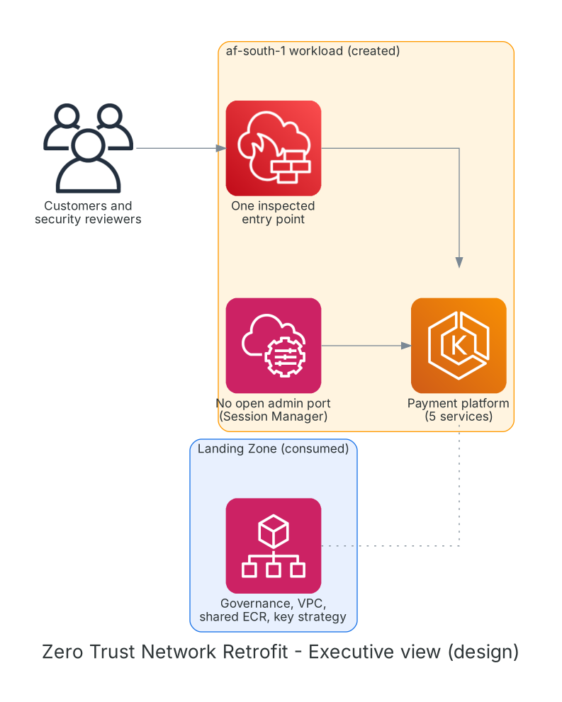

**Executive view.** Customers reach the platform through one inspected entry point; administrators reach nodes through Session Manager with no open port; the workload runs in the Landing Zone's private subnets. Blue is consumed from the Landing Zone, amber is created here. 

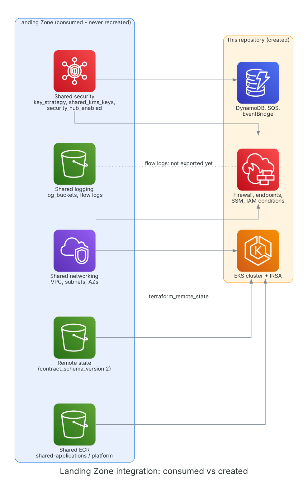

**Landing Zone integration.** This repository reads Landing Zone outputs (VPC, subnets, shared ECR, key strategy, Security Hub flag) through remote state and never recreates them. Details, gaps and the consumed/created inventory: [docs/landing-zone-integration.md](docs/landing-zone-integration.md).

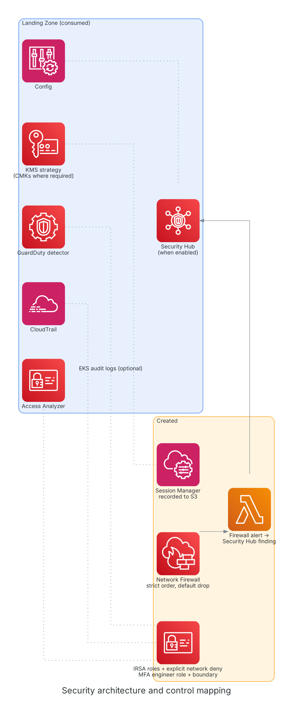

**Security architecture.** Network Firewall (strict order, default drop), IRSA roles with an explicit deny outside the VPC and its endpoints, Session Manager with recorded sessions, a break-glass engineer role with MFA and a permission boundary, and firewall alerts as Security Hub findings, on top of the Landing Zone's KMS strategy, Security Hub, GuardDuty, CloudTrail and Config. Threat model: [docs/threat-model.md](docs/threat-model.md).

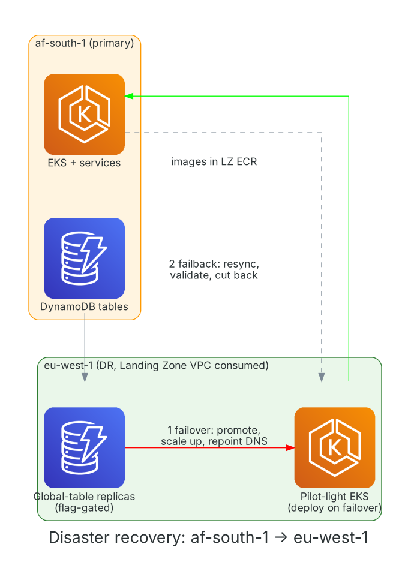

**Disaster recovery.** af-south-1 is primary; eu-west-1 (the Landing Zone's DR VPC) is the pilot-light recovery site with optional DynamoDB global-table replicas. RPO about 1 second with replicas, RTO about 60 minutes. [docs/dr-and-resilience.md](docs/dr-and-resilience.md).

More: [logical](architecture/diagrams/logical-architecture.png), [network](architecture/diagrams/network-architecture.png), [data flow](architecture/diagrams/data-flow-diagram.png), [Terraform deployment](architecture/diagrams/terraform-deployment-diagram.png).

---

## Table of Contents

- [What this repository covers](#what-this-repository-covers)
- [Regions and the Ireland rule](#regions-and-the-ireland-rule)
- [Encryption and FinOps](#encryption-and-finops)
- [Tech Stack](#tech-stack)
- [Repository layout](#repository-layout)
- [Deploying](#deploying)
- [Proof It Works](#proof-it-works)
- [Architecture Decisions](#architecture-decisions)
- [Documentation](#documentation)

---

## What this repository covers

One repository for zero trust on AWS, aligned with NIST SP 800-207. It combines a five-service payment platform on EKS with network controls (Network Firewall, private endpoints, Session Manager, IRSA deny rules) and the account-level identity and segmentation controls (MFA-gated engineer role with a permission boundary, security-group-to-security-group tiers). It runs in the Landing Zone VPC and consumes Landing Zone services (KMS strategy, GuardDuty, Security Hub, Config, CloudTrail, Access Analyzer, ECR) instead of recreating them: [docs/landing-zone-integration.md](docs/landing-zone-integration.md). The NIST tenet and pillar mapping is in [docs/nist-800-207-mapping.md](docs/nist-800-207-mapping.md).

## Regions and the Ireland rule

Primary af-south-1, DR eu-west-1, no other Region. A service that is not available in af-south-1 runs from eu-west-1 through an `ireland` provider alias, with the check date and sources recorded. The 2026-11-26 check found every service available in af-south-1, so nothing runs from Ireland: [docs/regional-availability.md](docs/regional-availability.md).

## Encryption and FinOps

Dev/Test use AWS-managed keys, Prod uses CMK where governance requires, following the LZ key_strategy.

Cost analysis: [docs/finops-and-kms.md](docs/finops-and-kms.md).

## Tech Stack

| Layer | Technology |
|---|---|
| IaC | Terraform >= 1.10, three stacks (cluster, data, zerotrust), AWS provider >= 6.27 and < 7.0, remote state in the Landing Zone bucket |
| Workload | EKS 1.35 (AL2023), Istio 1.30, Helm, five Python FastAPI services, images in the Landing Zone shared ECR |
| Data and events | DynamoDB (PITR, optional replicas), SQS with DLQs, EventBridge |
| Inspection | AWS Network Firewall (Suricata, strict order, default drop) |
| Private access | Gateway and interface VPC endpoints (created only if the Landing Zone lacks them) |
| Admin access | Session Manager, recordings in S3; optional MFA-gated engineer role |
| Identity | IRSA, explicit deny on `aws:SourceVpce` / `aws:SourceVpc`, permission boundary |
| Segmentation | Optional web/app/db security groups with security-group-to-security-group rules |
| Detection | Landing Zone GuardDuty / Security Hub, Lambda (python3.13) for firewall findings |
| Dashboard | React 19, Vite, Tailwind, local AWS proxy with masking |
| CI | terraform fmt and validate, tfsec, Checkov, Trivy, Gitleaks, Bandit |

## Repository layout

```text
infra/cluster      provider.tf, landing_zone.tf, EKS + IRSA (Landing Zone VPC, shared ECR)
infra/data         provider.tf, landing_zone.tf, DynamoDB, SQS, EventBridge
infra/zerotrust    provider.tf, landing_zone.tf, firewall, endpoints, Session Manager, IAM conditions,
                   engineer access, tier segmentation, firewall findings
environments/<env> backend.hcl, common and per-stack tfvars (examples only); dev, test, prod
architecture/      8 diagrams (scripts/generate-diagrams.py)
workloads/ scripts/ console/ tests/ docs/ proof/
```

## Deploying

Requirements: AWS CLI profile for the target account, Terraform 1.10+, kubectl, Helm, istioctl 1.30, Docker, Session Manager plugin, Node.js, Python 3.

```bash
# 0. Per environment: copy environments/dev/*.example to their real names and fill in the Landing Zone values
#    (terraform_state in the Landing Zone outputs gives the state bucket, key and Region).
# 1. Cluster, then data
scripts/tf.sh dev cluster init && scripts/tf.sh dev cluster apply
scripts/tf.sh dev data init    && scripts/tf.sh dev data apply
# 2. Mirror Istio images (no NAT in the Landing Zone), then deploy the workload
scripts/mirror_istio_images.sh
workloads/deploy.sh
# 3. Zero trust controls (set inspect_public_subnets = true only with Landing Zone owner approval)
scripts/tf.sh dev zerotrust init && scripts/tf.sh dev zerotrust apply
workloads/deploy.sh --skip-build         # points fraud detection at the Streams endpoint
# 4. Scenarios
scripts/kube_tunnel.sh start && export ZT_TUNNEL=1
scripts/demo_blocked_path.sh 04-blocked-path
# 5. Dashboard (set NAME_PREFIX and AWS_REGION_PRIMARY first)
cd console && npm install && npm run dev
```

Destroy in reverse order: zerotrust, data, cluster (delete the Istio load balancer first: `kubectl -n istio-system delete svc istio-ingressgateway`).

## Proof It Works

Measured on the first build of this platform (its own VPC and NAT gateway, before the Landing Zone integration). The scenarios and scripts are unchanged.

The before and after comparison comes from the same script run twice against the same VPC, with an external TCP scan of 1,046 ports per address from a machine outside AWS.

```bash
scripts/posture_snapshot.sh 02-posture-before   # first build
scripts/posture_snapshot.sh 08-posture-after    # after the retrofit
```

| Measured | Before | After |
|---|---|---|
| Open TCP ports on the public load balancer (both addresses) | 80, 443, 15021, 15443, 31400 | 80 |
| Kubernetes API endpoint | public, open to 0.0.0.0/0, port 443 open on both addresses | private only, resolves to two private addresses, nothing reachable |
| Open TCP ports on the NAT gateway address | none | none |
| Public IP addresses in the VPC | 3 (two load balancer nodes, one NAT) | 3 (same) |
| Worker nodes with a public IP | 0 of 2 | 0 of 2 |
| Security group inbound rules open to 0.0.0.0/0 | 6 | 6 |
| Traffic inspection | none | Network Firewall on every packet to and from the internet |

The last two rows are stated as measured. The six open rules belong to the security group Kubernetes creates for the Istio load balancer, which still allows ICMP and the five gateway ports; the reduction to port 80 comes from the firewall dropping the other four, not from the security group. Tightening the gateway's own service ports would be the next layer.
Full outputs: [proof/02-posture-before.txt](proof/02-posture-before.txt), [proof/08-posture-after.txt](proof/08-posture-after.txt).

The VPC before the retrofit: two public and two private subnets, one NAT gateway, no inspection.

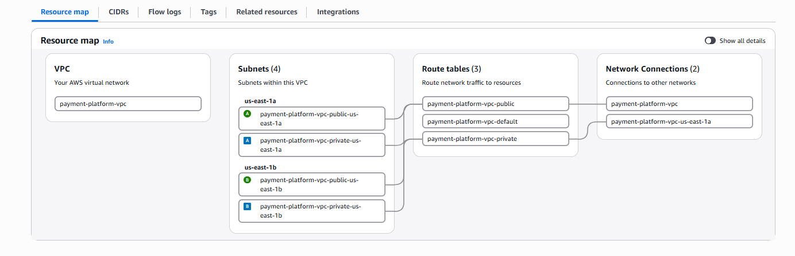

The same VPC after: a firewall subnet, a firewall route table, an edge route table on the internet gateway, and the gateway endpoints.

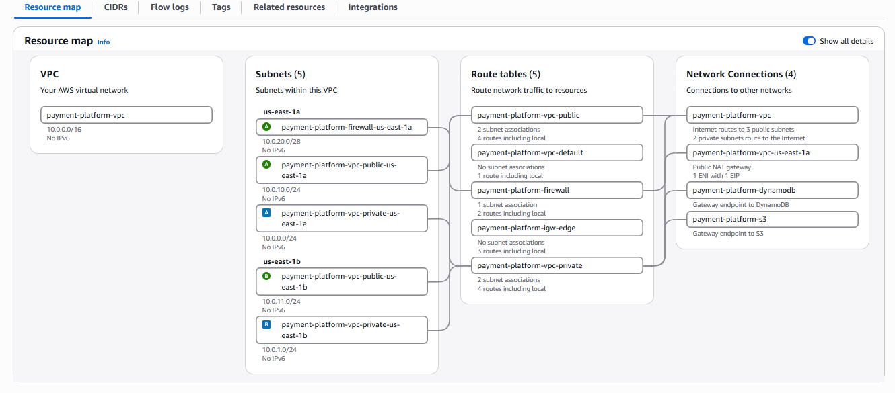

**Scenario 1, external scan.** Only the deliberate entry point answers, on port 80 only; see the table above.

**Scenario 2, blocked unauthorized path.** Requests outside the public API path, to the Istio status port, and from a pod to a domain that is not on the allowlist are dropped and logged with a readable reason, while the public API and the allowlisted registry still work.

```bash
scripts/demo_blocked_path.sh 04-blocked-path
```

```text
1. GET /api/wallets (the intended public API path): HTTP 200
2. GET /stats (a service endpoint outside the public API path): no response (curl exit 28)
3. GET /healthz/ready on the Istio status port 15021: no response (curl exit 28)
4. https://registry-1.docker.io/v2/ (allowlisted registry): HTTP 401 (reached the server)
5. https://example.com/ (not on the allowlist): no connection (URLError)
blocked  Ingress blocked: HTTP request outside the public API path  TCP  public-ip-2 -> 10.0.11.15:80  /stats
blocked  Egress blocked: TLS to a domain outside the allowlist      TCP  10.0.10.114 -> public-ip-21:443  example.com
```

Full output: [proof/04-blocked-path.txt](proof/04-blocked-path.txt). The firewall policy that produced it, with strict order and the application-layer default drop:

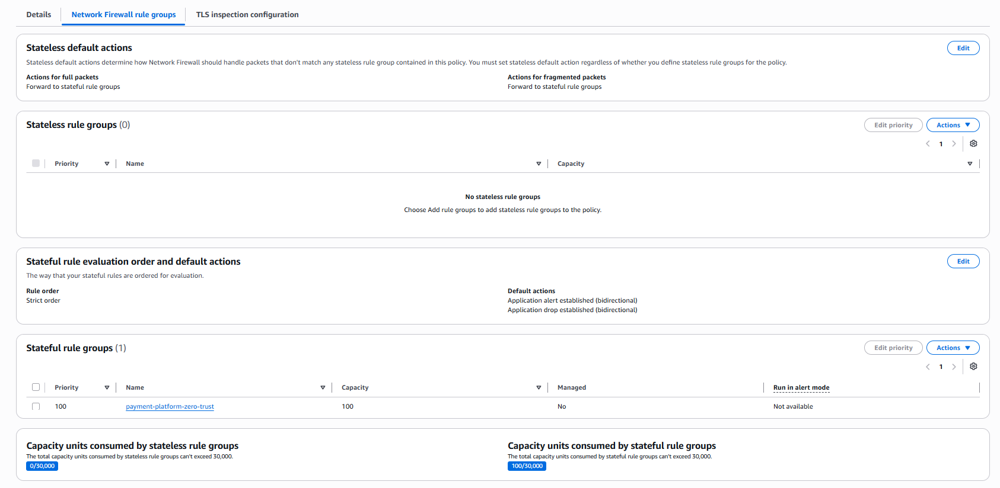

**Scenario 3, admin session with no open port.** A recorded shell on a worker node that has no public IP, no key pair, no security group rule from an IP range and none covering port 22. The SSH daemon of the EKS AMI is still listening on port 22 inside the node, as the session itself shows; it is unreachable, not absent. The node security group keeps eleven inbound rules that reference the cluster and node security groups, which Kubernetes needs, so the claim here is "no inbound rule from outside the VPC", not "zero inbound rules".

```bash
scripts/demo_admin_session.sh 06-admin-session
```

```text
inbound rules with an IPv4 CIDR source: 0
inbound rules covering port 22: 0
whoami: ssm-user
LISTEN 0      128          0.0.0.0:22         0.0.0.0:*
session-1  Terminated  ...  AWS-StartInteractiveCommand
```

Full output: [proof/06-admin-session.txt](proof/06-admin-session.txt).

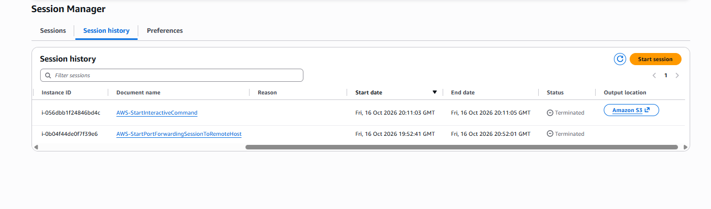

**Scenario 4, private path to DynamoDB.** Three transfers through the public API, then VPC Flow Logs for the nodes running the wallet and transaction pods: DynamoDB traffic took `traffic-path` 7 (through a gateway VPC endpoint), and no DynamoDB flow took path 8 (internet gateway).

```bash
scripts/demo_dynamodb_private_path.sh 07-dynamodb-private-path
```

```text
packet_source  aws_service  traffic_path  flows  bytes
10.0.0.81      -            1             4      71080
10.0.0.81      DYNAMODB     7             1      24190
```

Full output: [proof/07-dynamodb-private-path.txt](proof/07-dynamodb-private-path.txt).

**IAM context condition.** The wallet pod scans its table; the same role, assumed from outside AWS with a service account token, is refused by the explicit deny.

```bash
scripts/demo_iam_condition.sh 05-iam-condition
```

```text
scan OK, items returned: 1
assume-role-with-web-identity with a service account token: succeeded
dynamodb scan: An error occurred (AccessDeniedException) when calling the Scan operation: User: arn-1 is not authorized to perform: dynamodb:Scan on resource: arn-2 with an explicit deny in an identity-based policy
```

Full output: [proof/05-iam-condition.txt](proof/05-iam-condition.txt).

**Security Hub.** Firewall alerts arrive as custom findings, because Network Firewall is not a native finding source for Security Hub CSPM (see the decisions below).

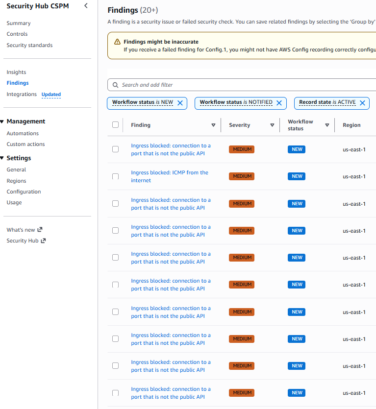

**Dashboard.** The four captures below are automated (Playwright, headless Chromium) against live AWS data, taken by `console/e2e/flow.mjs`. The blocked-attempt counters cover six hours and include the scans run for this project as well as unsolicited traffic from the internet.

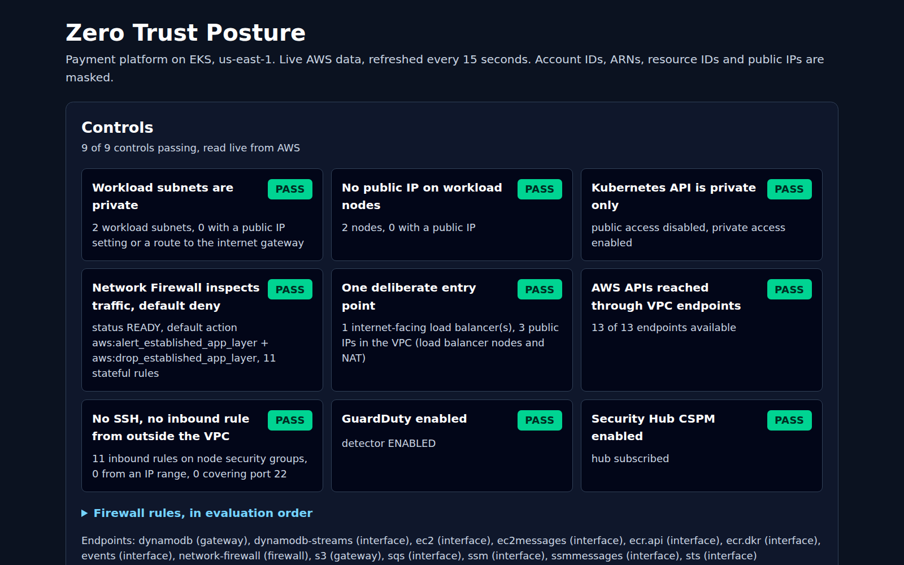

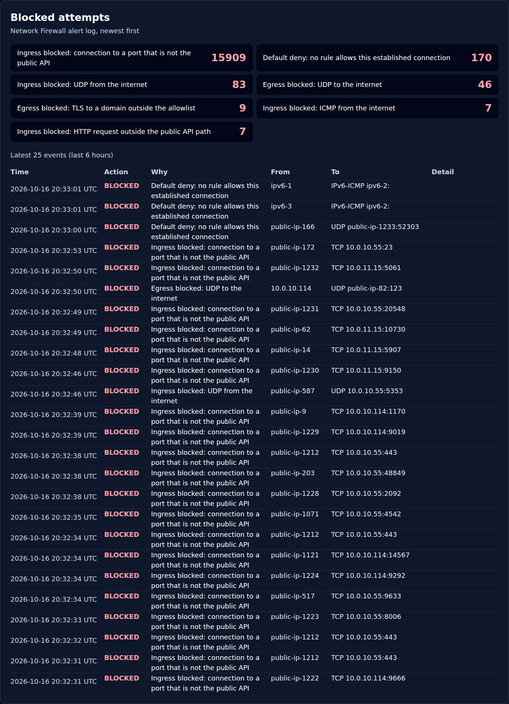

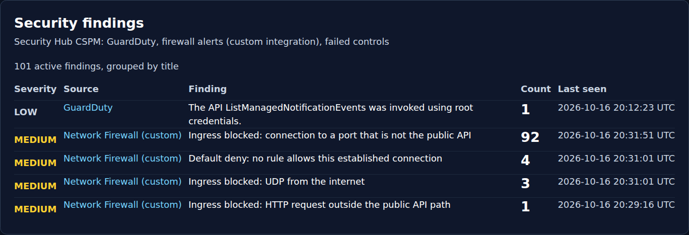

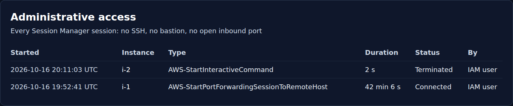

The GuardDuty finding on the dashboard is real: an API call made with the account's root credentials during the build.

## Architecture Decisions

Full records: [docs/DECISIONS.md](docs/DECISIONS.md) (ADR-013 onward cover the Landing Zone integration and the merge).

- **Consume, never recreate:** remote state plus a contract guard (ADR-013, ADR-014).
- **No NAT:** Istio images mirrored into the Landing Zone ECR (ADR-015).
- **Landing Zone routing is touched only on request:** `inspect_public_subnets` (ADR-016).
- **Shared account controls are conditional:** GuardDuty, Security Hub, flow logs (ADR-017).
- **Encryption follows the key strategy** (ADR-018) and **the Ireland rule** (ADR-019).
- **Identity and segmentation from the NIST-aligned repository:** MFA-gated engineer role, permission boundary, tier security groups (ADR-020 to ADR-022).
- Retained from the first build: Network Firewall over security groups alone, Session Manager over a bastion, explicit IAM deny over rewriting policies, a custom Lambda instead of claiming a native Security Hub integration.

## Documentation

[Landing Zone integration](docs/landing-zone-integration.md), [regional availability](docs/regional-availability.md), [threat model](docs/threat-model.md), [DR](docs/dr-and-resilience.md), [FinOps and KMS](docs/finops-and-kms.md), [testing strategy](docs/testing-strategy.md), [roadmap](docs/roadmap.md), [NIST mapping](docs/nist-800-207-mapping.md), [business case](docs/BUSINESS-CASE.md), [issues resolved](docs/ISSUES-RESOLVED.md), [project plan](docs/PROJECT_PLAN.md) and [dev log](docs/DEVLOG.md).

---

## Author

**Emmanuel Mulenga** — Multi-Cloud Engineer
- 🌐 [](https://www.linkedin.com/in/emmanuel-mulenga)
- 💻 [](https://github.com/e-mulenga)

---