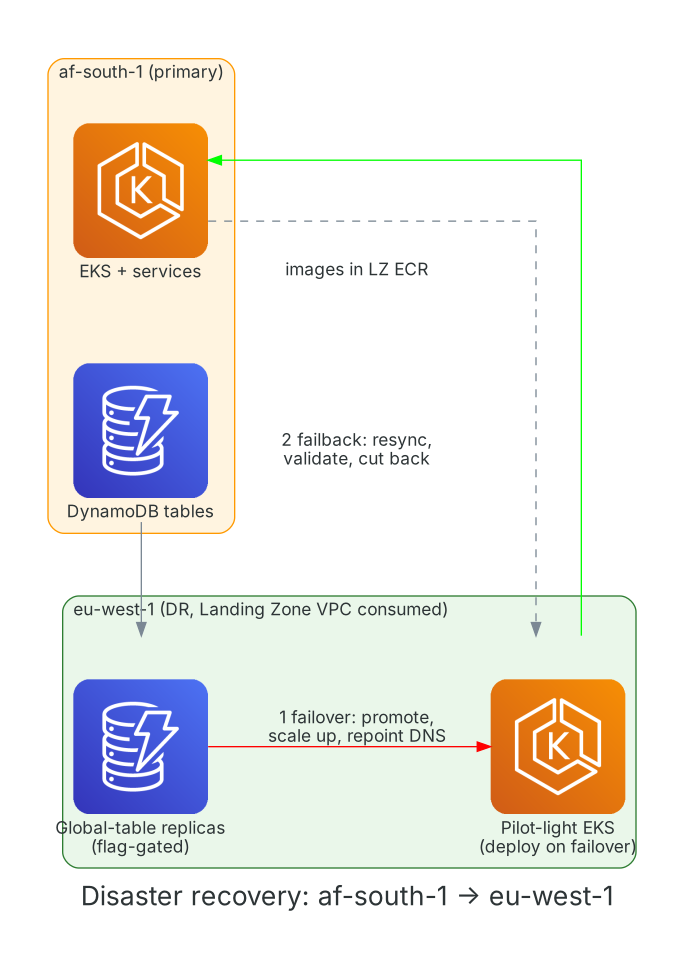

# Disaster recovery and resilience

**Diagram description:** af-south-1 is primary, eu-west-1 (the Landing Zone DR VPC) is the recovery site. **Service inventory:** DynamoDB global-table replicas, pilot-light EKS, shared ECR images. **Data flow:** asynchronous table replication; images are already in the Landing Zone ECR.

| | Target | Basis |
|---|---|---|
| RPO | about 1 second for DynamoDB tables with replicas; up to the last point-in-time restore point otherwise | Global tables replicate asynchronously; PITR is on by default |
| RTO | about 60 minutes | Pilot light: apply the stacks in eu-west-1, deploy, repoint DNS |

**Failover:** (1) declare the incident, (2) confirm replica health (prod runs with `enable_dynamodb_replication = true`), (3) apply `cluster`, `data` (reference replicas) and `zerotrust` with the eu-west-1 environment, (4) deploy workloads, (5) repoint DNS (the Route 53 zone is a Landing Zone output). **Failback:** resync from the eu-west-1 tables, validate, cut DNS back, then scale the DR cluster down.

The stacks run one Region at a time (`primary_region`); the DR environment is a re-run, not active-active. Prod uses `endpoint_az_count = 2`; one firewall endpoint per zone is on the roadmap.
