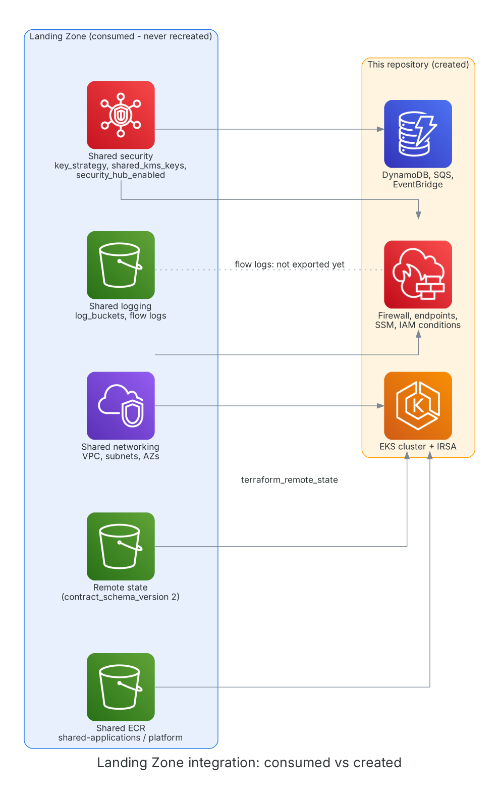

# Landing Zone integration

Source of truth: the Landing Zone outputs (`contract_schema_version = "2"`), read through `terraform_remote_state` in `infra/*/landing_zone.tf`. Nothing listed under "Consumed" is created here.

**Diagram description:** blue is consumed, amber is created. Arrows show which Landing Zone output feeds which stack. **Service inventory:** VPC and subnets, shared ECR, key strategy, Security Hub flag, Access Analyzer (consumed); EKS, DynamoDB, SQS, EventBridge, Network Firewall, endpoints, Session Manager, IAM conditions, engineer role, tier security groups (created). **Data flow:** state is read once per plan. **Security controls mapping:** see threat-model.md and nist-800-207-mapping.md.

## Consumed outputs

| Output | Used for |
|---|---|
| `af_south_1.vpc_id`, `vpc_cidr_block`, `azs`, `private_subnet_ids`, `public_subnet_ids` | EKS placement, endpoint and firewall placement, CIDR checks, tier security groups |
| `ecr_repository_urls` (`shared-applications`, `shared-platform`) | Service images; mirrored Istio images |
| `key_strategy`, `shared_kms_keys` | Encryption mode per environment (ADR-018) |
| `security_hub_enabled` | Gate for firewall-to-Security Hub findings |
| `access_analyzer_arn` | Continuous access verification (not recreated) |
| `vpc_interface_endpoints.af_south_1.service_names` | Skip interface endpoints the Landing Zone already provides |
| `vpc_flow_logs.af_south_1` | Refuse duplicate flow logs; dashboard log group |
| `eu_west_1` | DR Region reference for the replication flag |
| `terraform_state` | State bucket, key and Region of the Landing Zone for `backend.hcl` and the three `landing_zone_state_*` variables |
| `contract_schema_version` | Contract guard |

## Landing Zone services that replace the second repository's modules

| Earlier module (zero_trust_aws) | Replaced by |
|---|---|
| `network_microsegmentation` VPC, subnets, flow logs | Landing Zone VPC and subnets; tier security groups kept (`tier_segmentation.tf`) |
| `data_protection` KMS key, bucket, secret | Landing Zone `key_strategy` and `shared_kms_keys`; secrets live in the aws-secrets-manager repository |
| `logging_monitoring` CloudTrail, GuardDuty, Security Hub, Config | Landing Zone services, consumed |
| `iam_least_privilege` boundary, engineer role, Access Analyzer | Kept as `engineer_access.tf`; Access Analyzer consumed |

## Reused resources (looked up, never modified)

VPC, subnets, internet gateway, public and private route tables (read; routes added only when `inspect_public_subnets = true`), the EKS node IAM roles of our own cluster, any existing DynamoDB/S3 gateway endpoint.

## Newly created resources

| Stack | Resources |
|---|---|
| cluster | EKS cluster, managed node group, IRSA roles, additive subnet tags (`aws_ec2_tag`) |
| data | DynamoDB tables (PITR, SSE, optional replicas), SQS queues and DLQs, EventBridge bus |
| zerotrust | Firewall subnet/route table, Network Firewall, policy, rule group, log groups, missing VPC endpoints, Session Manager bucket and preferences document, IAM explicit-deny policies, engineer role and boundary (optional), tier security groups (optional), Lambda and subscription, budget (optional) |

## Items for the Landing Zone owner

1. `shared_kms_keys` ARNs are null (`key_strategy = aws-managed`): prod with `require_cmk = true` waits for CMKs. No `eks` slot exists; agree a mapping.
2. No route table IDs or IGW ID are exported: resolved by data source today.
3. No interface endpoints and no flow logs exported: the related features are gated.
4. No NAT (intentional, ADR-015).
5. Log buckets are in us-east-1: session recordings use a workload bucket in af-south-1.
