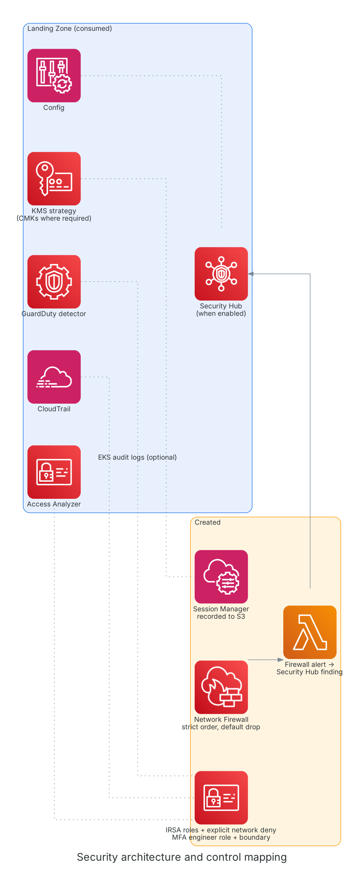

# Threat model (STRIDE, summary)

**Diagram description:** consumed Landing Zone controls (blue) and the controls this repo adds (amber). **Service inventory:** Network Firewall, IAM/IRSA, engineer role with boundary, Session Manager, Lambda, plus Landing Zone KMS, Security Hub, GuardDuty, CloudTrail, Config, Access Analyzer. **Data flow:** firewall alerts go to CloudWatch Logs, then Lambda, then Security Hub (when enabled). **Landing Zone dependencies:** key strategy, Security Hub flag, detector, trails, analyzer.

| Threat | Control | Residual risk |
|---|---|---|
| Spoofing: stolen pod token used from outside AWS | IRSA role with explicit deny unless `aws:SourceVpce` / `aws:SourceVpc` matches | Attacker inside the VPC |
| Spoofing: human credentials reused | Engineer role requires MFA no older than one hour, one-hour session; day-to-day access via Landing Zone Identity Center | Compromised MFA device |
| Tampering: unauthorised path to a service | Firewall default drop, `/api/` only; private subnets, no public IPs; tier security groups reference security groups only | Application-layer flaws on `/api/` |
| Repudiation: unlogged admin action | Session Manager only, sessions recorded to S3, CloudTrail (Landing Zone) | Recording gaps if the preferences document is not managed (`manage_session_preferences`) |
| Information disclosure: AWS API traffic over the internet | Gateway and interface endpoints; no NAT in the Landing Zone | Endpoint policies are default (roadmap) |
| Denial of service on the entry point | Single inspected entry; WAF on the roadmap | Volumetric attacks |
| Elevation: open admin port or role escalation | No SSH, no bastion, private EKS API; permission boundary denies IAM escalation and leaving the boundary; explicit deny outside af-south-1 and eu-west-1 | Node SG cluster-internal rules |
| Supply chain: images | Shared ECR only; Trivy and Checkov in CI | Mirrored Istio images are trusted at mirror time |

Not covered: DDoS, application authentication, data classification.
